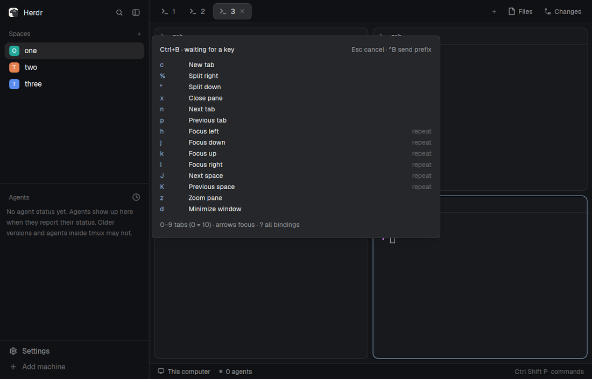

# Herdr Tmux Prefix

**Tmux-style shortcuts. A quiet footer. Help when you ask for it.**

[](https://herdr.dev)

[](LICENSE)

Press <kbd>Ctrl</kbd> + <kbd>B</kbd>, release, then press a command key to split panes, move focus or switch tabs. Only a muted gray **`[prefix]`** appears in the footer. Press <kbd>?</kbd> to open the full shortcut table.

[Features](#features) · [Installation](#installation) · [Keymap](#keymap) · [Customization](#customization) · [Verification](#verification)

## Features

- **Prefix-first controls:** splits, pane navigation, tabs, spaces and zoom.
- **A quiet indicator:** gray text aligned with the bottom-right footer, without a background or badge.
- **On-demand help:** `Ctrl+B`, then `?` shows the full table; another `?` hides it.
- **Repeatable navigation:** move between panes or spaces again within 500ms without another prefix.
- **Existing shortcuts preserved:** no layout changes; Cmd+D and other bindings remain available.
- **No build step:** uses Herdr app and herdr-core, with no extra runtime packages.

> [!IMPORTANT]
> Ctrl+B is intercepted from terminal programs, including tmux. Press **Ctrl+B twice** to send a literal Ctrl+B to the focused terminal.

## Installation

### Requirements

- Herdr app and its `herdr-app` CLI.
- herdr-core (`hc`).
- Frameless-overlay support (`frame: "none"`). Validated with Herdr app **0.1.16**.

### 1. Copy the mod

```sh
git clone https://github.com/Gwynbleid85/herdr-tmux-prefix.git
cd herdr-tmux-prefix

# Stop if a copy is already installed; see the upgrade instructions below.
test ! -e ~/.config/herdr-app/mods/tmux-prefix && \
  mkdir -p ~/.config/herdr-app/mods && \
  cp -R mods/tmux-prefix ~/.config/herdr-app/mods/
```

### 2. Merge the shortcuts

Back up your existing shortcuts:

```sh
cp ~/.config/herdr-app/keys.json \
  ~/.config/herdr-app/keys.json.backup-$(date +%Y%m%d-%H%M%S)
```

Add these entries to the corresponding sections of `~/.config/herdr-app/keys.json`. The same snippet is provided in [`keys.json`](keys.json).

```json
{
  "global": { "ctrl-b": "mod.open:tmux-prefix" },
  "terminal": { "ctrl-b": "mod.open:tmux-prefix" },
  "mod:tmux-prefix": { "ctrl-b": "tmux-prefix.send-prefix" }
}
```

> [!WARNING]
> **Merge, do not replace the file.** Preserve existing keys and sections. Resolve conflicting `ctrl-b` bindings first, including any in `layout:<name>` sections.

### 3. Validate and try it

```sh
herdr-app check ~/.config/herdr-app/mods/tmux-prefix
```

Press `Ctrl+B`, then `%` to split right, or `Ctrl+B`, then `?` for help. If an older prefix overlay is open during an upgrade, close it with Escape before trying the new copy.

## Keymap

All keys below follow **Ctrl+B**:

| Key | Action |
| --- | --- |
| `?` | Show or hide the full help table |
| `%` / `"` | Split right / down |
| `h` `j` `k` `l` or arrows | Focus left / down / up / right |
| `x` | Close the focused pane **and end its terminal** |
| `z` | Toggle pane zoom |
| `c` | New tab |
| `n` / `p` | Next / previous tab |
| `1`–`9`, `0` | Select tab 1–9, 10 |
| `J` / `K` | Next / previous space |
| `d` | Minimize the window; this is **not** tmux detach |
| Escape | Cancel prefix mode |
| Ctrl+B | Send a literal Ctrl+B to the terminal |

### Waiting, repeats and cancellation

The first command has **no timeout**. The footer indicator remains visible while prefix mode is active, including during help and repeats, and disappears when prefix mode ends.

Pane focus and space navigation allow repeats for **500ms** after each action. For example, `Ctrl+B`, `J`, `J`, `K` moves two spaces forward and one back. Pressing `?` cancels the repeat timeout and leaves prefix mode waiting.

Escape or a click outside the help table cancels prefix mode. An unbound key initially dismisses it without typing. During repeats, supported simple keys are forwarded to the terminal; shifted punctuation, Unicode and modified shortcuts are not replayed.

<details>
<summary>Help-table preview</summary>



This image comes from the upstream example and shows the help table, not the current footer styling. The full table appears only when requested with `?`.

</details>

## Customization

Edit [`mods/tmux-prefix/main.js`](mods/tmux-prefix/main.js):

| Setting | Purpose |
| --- | --- |
| `BINDINGS` | Command keys, labels, arguments and repeat behavior |
| `REPEAT_MS` | Navigation repeat window, currently 500ms |
| Indicator rendering | Muted theme color, 11.8px text, 28px footer-height row and 14px right inset |

The transparent overlay uses the current window viewport rather than a fixed screen resolution. The mod invokes `hc` to forward literal keys; it makes no network requests and reads no external files.

## Verification

From this repository, run the tests with Node's built-in test runner:

```sh
node --test
herdr-app check "$PWD/mods/tmux-prefix"
```

Tests execute the actual mod with native Herdr/GPUI boundaries stubbed. Also check it in Herdr: the footer indicator appears after Ctrl+B, `?` opens help, `%` splits, Escape clears the indicator, and Ctrl+B twice forwards the prefix.

## Upgrade or remove

**Upgrade:** back up the installed mod folder outside `mods/`, replace `main.js` and `mod.json` with this repository's files, and validate again. Keep your existing `keys.json`.

**Uninstall:** close prefix mode, remove the three shortcut entries or restore your previous Ctrl+B bindings, then remove `~/.config/herdr-app/mods/tmux-prefix`.

Restore a whole keys-file backup only if you have made no later shortcut edits.

## Attribution and license

Adapted from [Herdr's tmux-prefix example](https://github.com/herdrdev/herdr-layout-examples/tree/main/tmux-prefix). The original mod's relevant Git history is preserved. This is an unofficial customization, not a terminal multiplexer.

Licensed under [Apache-2.0](LICENSE). See [`RECIPE.md`](RECIPE.md) for the behavior and implementation brief.
